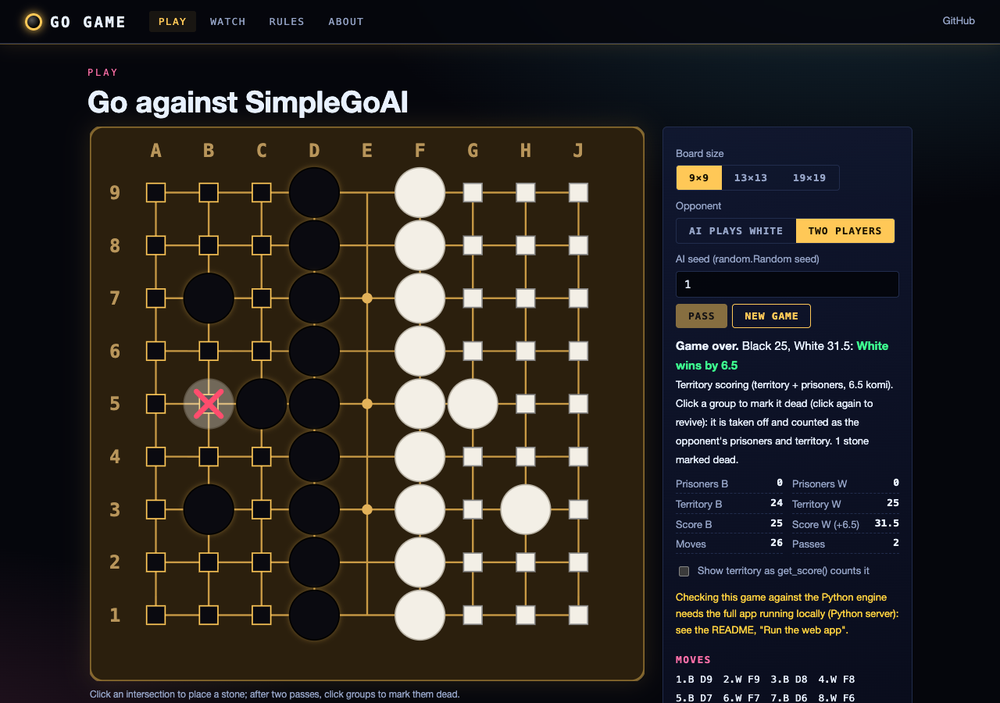
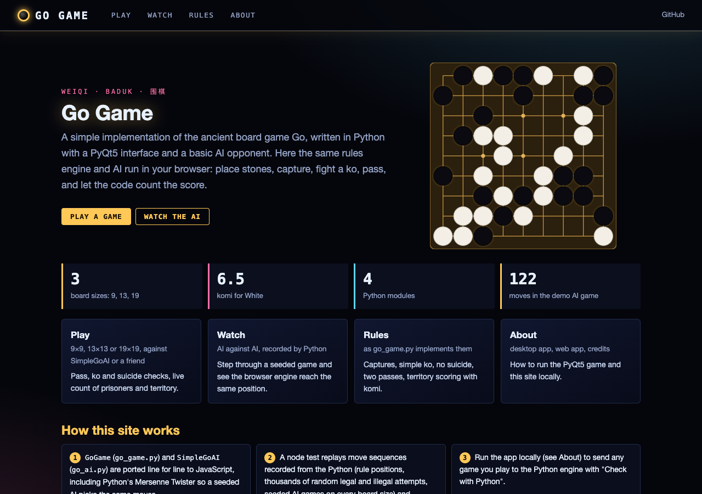
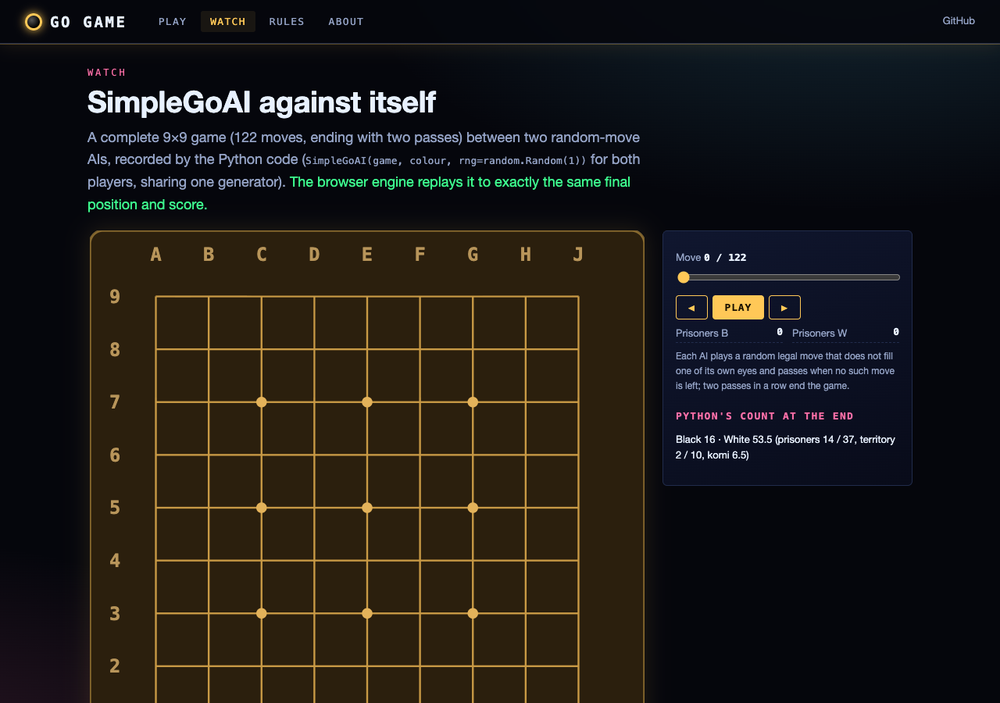
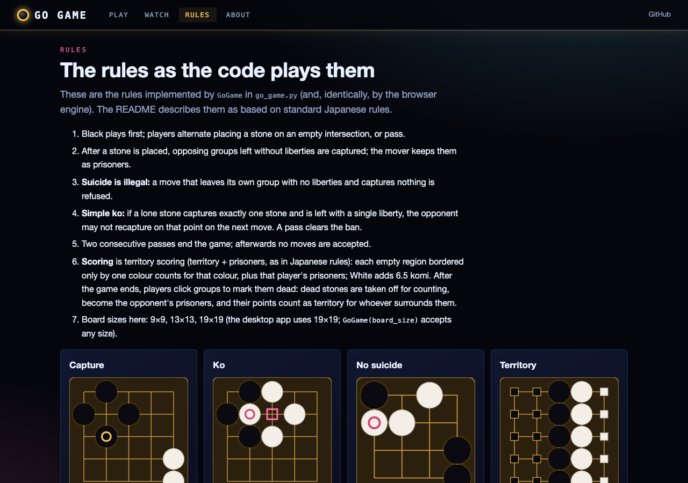

# Go Game

A simple implementation of the ancient board game Go (also known as Weiqi, Baduk) with a graphical user interface built using PyQt5 and a basic AI opponent.

**Play it in your browser: https://gddickinson.github.io/go/** (the same rules engine and AI, ported to JavaScript).



## Features

- Full implementation of Go game rules including:
  - Stone capture
  - Ko rule prevention (simple ko)
  - Suicide prevention
  - Territory scoring
  - Komi (6.5 points advantage for white)
- Simple GUI with:
  - Interactive board for placing stones
  - Game status display
  - Pass button for skipping turns
- AI opponent that makes random valid moves

## Requirements

- Python 3.9+
- PyQt5
- NumPy

## Installation

1. Clone the repository:
   ```
   git clone https://github.com/gddickinson/go.git
   cd go
   ```

2. Install the required dependencies:
   ```
   pip install numpy pyqt5
   ```

## Usage

Run the main script to start the game:

```
python go_main.py
```

### Game Controls

- **Place a stone**: Click on an intersection on the board
- **Pass your turn**: Click the "Pass" button
- **End the game**: Both players pass consecutively (the AI passes when it has nothing left but its own eyes)
- **Mark dead stones**: After the game, click a group to mark it dead (click again to revive); the score updates

## Project Structure

- `go_game.py`: Core game logic and rules implementation
- `go_ai.py`: Simple AI implementation
- `go_gui.py`: GUI implementation using PyQt5
- `go_main.py`: Main entry point to run the application

## Game Rules

This implementation follows standard Go rules:

1. Players take turns placing stones on the intersections of the board
2. Black plays first
3. Stones that are completely surrounded by the opponent's stones are captured
4. The Ko rule prevents immediate recapture of a single stone (a pass lifts the ban)
5. Suicide (a move that leaves your own group with no liberties without capturing) is not allowed
6. The game ends when both players pass consecutively
7. Scoring is territory scoring (as in Japanese rules): empty intersections surrounded by one colour, plus prisoners. Groups the players mark dead after the game are removed and count as prisoners, and their points as territory
8. White receives a 6.5 point komi (compensation for black's first-move advantage)

## Web version

The `web/` folder holds a browser version built on the same code: `GoGame` and `SimpleGoAI` are ported line for line
to JavaScript (`web/static/go_engine.js`, `go_ai.js`, and `py_random.js`, a port of Python's Mersenne Twister so a
seeded AI picks the same moves), and a node test replays move sequences recorded from the Python (rule positions,
random legal and illegal attempts, seeded AI games on 5x5 to 19x19) and requires identical results.

Pages: **Play** (9x9, 13x13 or 19x19 against the AI as White, or two players; pass, ko and suicide feedback, live
prisoners/territory/score, dead-stone marking after the game, keyboard play), **Watch** (a seeded AI-vs-AI game recorded by Python), **Rules** (the
rules as the code implements them, with example positions) and **About**.

| Home | Play | Watch | Rules |
|---|---|---|---|
|  |  |  |  |

```
pip install -r requirements-web.txt
python run_web.py                      # http://127.0.0.1:8160 (adds "Check with Python" on the Play page)
python scripts/build_static.py         # static site in site/ (published to GitHub Pages by .github/workflows/pages.yml)
python -m pytest -q                    # game, rule-regression, packaging and web tests (incl. the node engine test)
python scripts/make_engine_fixtures.py # regenerate the Python-recorded fixtures after changing the rules
```

### History

An earlier standalone browser version lived in `go-web/` (a single-page HTML/JS game written separately from the
Python code). It had its own rule bugs (its AI could play suicide moves, its ko banned any one-stone retake, and it
had no scoring), so it was removed in November 2026 in favour of `web/`, which is tested against the Python engine.
It remains in the git history (commit 3ad92cb).

## AI Implementation

The current AI implementation (`SimpleGoAI` class) makes random valid (legal) moves, except that it never fills one of its own eyes (`GoGame.is_eye`: all four neighbours its own stones, at most one opponent diagonal, none on the edge); when no other move is left it passes, so games end with two passes. Pass it `rng=random.Random(seed)` for a reproducible game. This provides a basic opponent but isn't very challenging. Future improvements could include more sophisticated algorithms like Monte Carlo Tree Search.

## Future Enhancements

- Implement a stronger AI using techniques like MCTS or neural networks
- Add game history and the ability to review moves
- Support for different board sizes (9x9, 13x13, 19x19)
- Save/load game functionality
- Network play support
- Implement handicap stones for balanced gameplay

## Contributing

Contributions are welcome! Please feel free to submit a Pull Request.

1. Fork the repository
2. Create your feature branch (`git checkout -b feature/amazing-feature`)
3. Commit your changes (`git commit -m 'Add some amazing feature'`)
4. Push to the branch (`git push origin feature/amazing-feature`)
5. Open a Pull Request

## License

This project is licensed under the MIT License - see the LICENSE file for details.

## Acknowledgments

- The rules of Go are based on standard Japanese rules
- Thanks to the PyQt5 team for the excellent GUI framework
- Inspired by the rich history of Go spanning over 2,500 years


---
*Built with AI assistance from [Claude (Anthropic)](https://claude.com/).*
